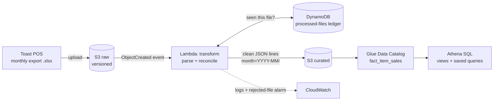

# Restaurant AI Analyst on AWS

A serverless data pipeline (and, in phase 2, an AI analyst) that turns a restaurant's
Toast POS exports into a queryable sales warehouse on AWS. It's built with real data
from Ozora Izakaya.

**Phase 1 (this repo today):** drop a Toast "Product Mix" export into S3 → a Lambda
checks it, cleans it and stores it → the owner's questions become SQL in Athena.



**Phase 2 (next):** an AI agent (Claude on Amazon Bedrock) answers plain-English
questions by writing read-only SQL against this warehouse, exposed through an MCP server.
**Phase 3:** an evaluation set of test questions to measure accuracy, cost and safety.

## What it does well
- **Data quality gate:** every file must add up to Toast's own grand total, or it's rejected.
- **Idempotent:** processing the same file twice never double counts (DynamoDB ledger + one output file per month).
- **No servers, near-zero cost:** S3, Lambda, DynamoDB on-demand, Athena pay-per-query.
- **Cost guardrails:** Athena refuses any query that would scan over 1 GB; optional monthly budget email.
- **Infrastructure as code:** everything is Terraform; `terraform destroy` removes it all.
- **Tested:** unit tests for the parser and end-to-end Lambda tests against mocked AWS, run in GitHub Actions.

## Quick start
```bash
# 1. Try it locally, no AWS needed
pip install -r src/transform/requirements.txt -r requirements-dev.txt
pytest -q
python scripts/run_local.py data/raw/*.xlsx

# 2. Deploy (needs AWS CLI + Terraform, see docs/GUIDE.md)
./scripts/build_lambda.sh
terraform -chdir=terraform init
terraform -chdir=terraform apply

# 3. Load data and query it
./scripts/upload.sh data/raw/*.xlsx
./scripts/athena.sh sql/01_create_dim_menu_item.sql
./scripts/athena.sh sql/02_create_monthly_summary.sql
./scripts/athena.sh sql/top_and_bottom_items.sql
```

Step-by-step instructions, with what each part teaches you: [docs/GUIDE.md](docs/GUIDE.md).
Why it's built this way: [docs/DECISIONS.md](docs/DECISIONS.md).

## Data
Real exports live in `data/raw/` and are **git-ignored**. They belong to the restaurant;
get the owner's OK before showing any figures publicly. Tests use a small fake export.
