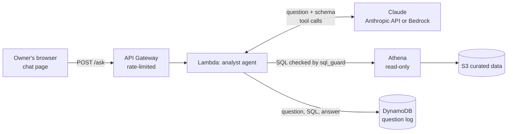

# Phase 2: the AI analyst

The owner types a question in plain English. The AI writes SQL, runs it read-only in Athena,
and answers with real numbers. Every question, query and answer is logged.



## How it works, simply

Imagine a new assistant who's great with numbers but has never seen the restaurant's books.

1. You give them a **cheat sheet** of what's in the filing cabinet (`schema.py`).
2. You give them **one tool**: they can ask the cabinet a question in SQL (`run_sql`).
3. Before any question reaches the cabinet, a **security guard** (`sql_guard.py`) checks it:
   reading is allowed, changing or deleting anything is blocked, and only the sales tables can be touched.
4. They can ask up to 6 questions, then must answer you in plain English, using only numbers they got back.
5. A **notebook** (DynamoDB) records every question, every query and every answer.

The AI never gets the data up front, and it never gets permission to change it. Even if someone tricks
it into writing `DROP TABLE`, the guard blocks it, and the Lambda's IAM role has no permission to do it anyway.
Two locks, not one.

## Steps

### 1. Give the Lambda a way to reach Claude (one time, 5 min)

The analyst can call Claude two ways, picked by one Terraform setting, `model_provider`:

| `model_provider` | Where Claude runs | What you need |
| --- | --- | --- |
| `anthropic` (default) | Anthropic's API | An API key from console.anthropic.com, stored in SSM Parameter Store |
| `bedrock` | Amazon Bedrock | Bedrock model access on the AWS account |

**Why the default is `anthropic`:** in October 2026 AWS declined Bedrock access for Claude on this
account because it is new and has little usage history. The agent was built against Bedrock's
Converse API, so a small adapter (`anthropic_client.py`) speaks that same API but sends the request
to Anthropic instead. Nothing else changed: same agent loop, same guard, same tests, same audit log.
When the account qualifies for Bedrock, switch back with `-var="model_provider=bedrock"`.

To set up the Anthropic key:
1. console.anthropic.com → **API keys** → **Create key**. Add a few dollars of credit under **Billing**.
2. AWS console → region **Oregon (us-west-2)** → **Systems Manager** → **Parameter Store** → **Create parameter**:
   - Name: `/restaurant-ai-analyst/anthropic-api-key`
   - Type: **SecureString** (encrypted), default KMS key
   - Value: the API key
   The key never goes in code, git or Terraform state. Only the analyst Lambda can read it.

### 2. Deploy
```bash
./scripts/build_lambda.sh
terraform -chdir=terraform plan  -var="alert_email=bilenkhbileg@gmail.com"
terraform -chdir=terraform apply -var="alert_email=bilenkhbileg@gmail.com"
```
Expect a few resources to change (the Lambda and its permissions), **0 to destroy**.

### 3. Open it
```bash
terraform -chdir=terraform output -raw analyst_url; echo
terraform -chdir=terraform output -raw analyst_access_key; echo
```
Open the URL in your browser, ask a question, paste the access key when asked.
Click **Show the SQL it ran** under any answer to see exactly what it did.

### 4. Measure it
```bash
python scripts/run_evals.py
```
22 questions with answers computed directly from the data, including trick questions
(days of the week, a month that isn't loaded, "delete the data"). It prints the score,
median answer time and tokens used. **That score is your resume number.**

## Cost
Claude Haiku 5.5 is Anthropic's cheapest current model (check the pricing page for exact rates).
One question uses roughly 3,000-8,000 tokens, so well under 1 cent. A full eval run costs cents.
API Gateway is throttled to 2 requests per second, and the page needs the access key.

## Interview questions

- **How do you stop the AI from making up numbers?** It only sees data through the tool, the prompt
  says to use only returned numbers, and the eval set checks answers against ground truth.
- **What stops it from deleting data?** Three layers: the SQL guard allows only single SELECTs on
  three tables, the IAM role has read-only access to the data, and every query is logged for review.
- **How do you know it works?** A 22-question eval set with known answers, run against the live system.
- **Why does it support both Bedrock and the Anthropic API?** Bedrock keeps everything inside AWS (IAM
  instead of an API key, one bill), which regulated customers prefer. But AWS declined Bedrock access for
  this new account, so I added a small adapter that speaks the same Converse format and calls Anthropic
  directly. The agent, guard and tests didn't change; the provider is one config setting. Real projects
  hit vendor constraints, and designing for a swap made it a 1-hour fix instead of a rewrite.
- **What would you add next?** More test questions, a cheaper/faster model for simple questions,
  and caching for repeated questions.
